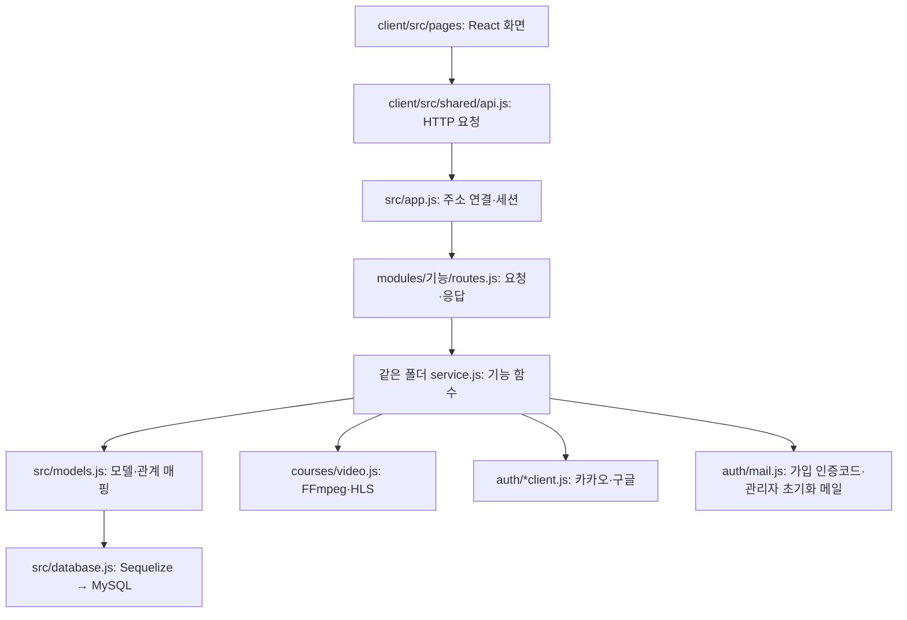
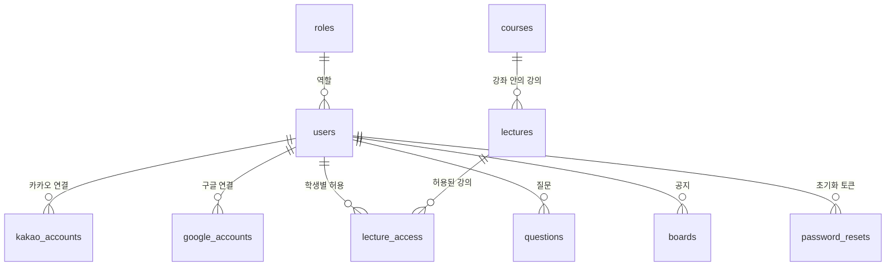

# 구조 지도

2026-11-16. [인수인계서](HANDOFF.md)와 함께 읽는다. 화살표는 요청이 흘러가는 방향이다.



## 폴더 맵

```text
MathSite/
├─ client/src/                         브라우저
│  ├─ App.jsx                         화면 주소표
│  ├─ pages/                          로그인·가입·프로필·강좌·게시판
│  │  └─ manager/                     회원·강좌 탭 및 관리 폼
│  └─ shared/
│     ├─ auth.jsx                     로그인·항목 설정 공통 상태
│     ├─ MemberFields.jsx             설정을 반영한 공통 회원 입력
│     └─ api.js / hooks.js            요청·처리 중·오류 상태
├─ src/                               서버
│  ├─ server.js / app.js              실행 / API 연결
│  ├─ models.js / database.js         테이블 매핑 / DB 접속
│  ├─ middleware/session-user.js      현재 계정·세션 검사
│  └─ modules/
│     ├─ auth/                        일반·소셜 로그인·비밀번호
│     │  ├─ routes.js / service.js
│     │  ├─ register.service.js       이메일 중복 확인·코드 발급·승인 대기 가입
│     │  ├─ social.service.js         구글·카카오 공통 인증 흐름
│     │  ├─ kakao.* / google.*        공급자별 경로·통신·매핑 저장
│     │  └─ account.js / password.js / mail.js / session.js
│     ├─ user/                        routes.js / service.js
│     ├─ manager/                     routes.js / service.js
│     │  └─ member-fields.service.js  회원 항목 공통 정책
│     ├─ courses/                     routes.js / service.js
│     │  ├─ lectures.routes.js / lectures.service.js
│     │  └─ access.js / upload.js / video.js
│     ├─ boards/                      routes.js / service.js
│     └─ info/                        routes.js / service.js
├─ database/migrate.js                매핑 기반 기존 DB 변경
├─ scripts/                           초기화·로컬 DB·Nginx 도구
├─ tests/                             Mocha 통합 검사·합성 자료
├─ server/nginx.conf.template         영상 내부 전송 설정
└─ docs/                              인수인계와 함수 설명
```

## 관리자 화면 연결

| 화면                    | React 파일                 | 서버 기능                        |
| ----------------------- | -------------------------- | -------------------------------- |
| 회원 탭                 | manager/ManagerPage.jsx    | manager 라우터                   |
| 가입 항목 스위치        | manager/MemberSettings.jsx | manager/member-fields.service.js |
| 회원정보·역할·시청 권한 | manager/MemberManager.jsx  | manager/service.js               |
| 역할 종류               | manager/RoleManager.jsx    | manager/service.js               |
| 강좌 탭                 | manager/CourseManager.jsx  | courses/service.js               |
| 선택 강좌 안의 강의     | manager/LectureManager.jsx | courses/lectures.service.js      |

화면 경로 `/manager`는 한 개지만 탭에 따라 렌더링하는 컴포넌트가 달라진다. 강좌·강의 관리도 같은 courses API를 쓰며 서버가 관리자 여부를 검사한다.

## 데이터 관계



member_fields는 사이트 전체의 회원 항목 정책이다. 회원별 권한과는 별개이며 가입·프로필·관리자 응답이 같은 설정을 읽는다.

signup_codes는 가입 전 주소별 인증 정보를 보관한다. 회원은 코드 검증이 끝나야 users에 생기므로 이 테이블에는 회원 번호가 없다.

## 강좌 아래에 강의 라우터를 연결하는 이유

`courses/routes.js`의 `router.use('/:courseId/lectures', ...)`가 강의 Router를 연결한다. 따라서 주소는 `/api/courses/1/lectures/2`지만 코드는 강좌 함수와 강의 함수로 나뉜다. `mergeParams:true`로 상위 courseId를 전달하고 서버에서 해당 강의가 그 강좌에 속하는지도 검사한다.
