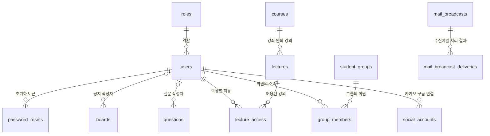

# 화면에서 서버까지 읽는 순서

```text
client/src/App.jsx               화면 주소 → React 페이지
  pages/manager/                 회원 관리 · 회원 그룹 · 가입/로그인 설정 · 메일 관리 · 메일 발송
  pages/courses/                 강좌 목록 · 강좌 상세 · 강의 재생 · 관리자 편집
  pages/RegisterPage.jsx         학생 가입
  shared/                        회원 입력칸 · 세션 상태 · HTTP 요청
src/app.js                       /api 주소 → Express 라우터
  modules/auth/                  가입 · 로그인 · 소셜 인증과 계정 연결
  modules/user/                  내 정보 · 공통 회원 항목 정책
  modules/manager/               회원 · 그룹 · 설정 변경 보호 · 학생 메일 대상
  modules/mail/                  발신자 등록 · 암호화 보관 · 공통 메일 전송
  modules/courses/               강좌 · 하위 강의 · 시청 권한 · 업로드
  modules/boards/ · info/        공지 · Q&A
src/models.js → src/database.js   Sequelize 모델 → MySQL
tests/                           기능별 Mocha 테스트
```

## 수정하려는 기능에서 출발하기

| 고치고 싶은 동작                | React에서 시작                                                                                                                       | 서버에서 이어 읽기                                                                                                                                                                                                                           |
| ------------------------------- | ------------------------------------------------------------------------------------------------------------------------------------ | -------------------------------------------------------------------------------------------------------------------------------------------------------------------------------------------------------------------------------------------- |
| 회원 승인·역할·학생별 시청 기간 | [회원 선택](../client/src/pages/manager/MemberManager.jsx), [시청 권한](../client/src/pages/manager/StudentAccess.jsx)               | [관리 라우터](../src/modules/manager/routes.js) → [회원 승인](../src/modules/manager/service.js) · [역할](../src/modules/manager/roles.service.js) · [학생별 시청 권한](../src/modules/manager/lecture-access.service.js)                    |
| 가입·로그인 옵션                | [설정 스위치](../client/src/pages/manager/MemberSettings.jsx), [로그인 화면](../client/src/pages/LoginPage.jsx)                      | [회원 항목 정책](../src/modules/user/member-fields.service.js) → [관리자 설정 저장·보호](../src/modules/manager/member-settings.service.js). 화면용 설정은 [인증 서비스](../src/modules/auth/service.js)의 `publicConfiguration`으로 읽는다. |
| 가입 중복 확인과 인증코드       | [가입 화면](../client/src/pages/RegisterPage.jsx), [공통 입력과 중복 확인](../client/src/shared/MemberFields.jsx)                    | [인증 API](../src/modules/auth/routes.js) → [가입 서비스](../src/modules/auth/register.service.js)                                                                                                                                           |
| 그룹 편성·강의 권한             | [그룹 편집](../client/src/pages/manager/GroupManager.jsx), [일괄 권한](../client/src/pages/manager/GroupAccess.jsx)                  | [그룹 라우터](../src/modules/manager/groups.routes.js) → [소속·권한 서비스](../src/modules/manager/groups.service.js)                                                                                                                        |
| 학생 안내 메일 작성·발송 결과   | [발송 화면](../client/src/pages/manager/MailCompose.jsx), [공통 학생 체크 목록](../client/src/pages/manager/StudentChecklist.jsx)    | [발송 라우터](../src/modules/manager/broadcast.routes.js) → [수신자 검사·발송 처리](../src/modules/manager/broadcast.service.js)                                                                                                             |
| 발신자 교체                     | [메일 관리](../client/src/pages/manager/MailSettings.jsx)                                                                            | [메일 확인·적용](../src/modules/mail/sender.service.js) → [비공개 설정 저장](../src/modules/mail/sender.store.js). 실제 발송은 [메일 전송](../src/modules/mail/transport.js)이 담당한다.                                                     |
| 관리자에게 편집 버튼 표시       | [학생·원장 공용 강좌 페이지](../client/src/pages/courses/CoursesPage.jsx), [강좌 편집](../client/src/pages/courses/CourseEditor.jsx) | [강좌 라우터](../src/modules/courses/routes.js) → [강좌 서비스](../src/modules/courses/service.js)                                                                                                                                           |
| 영상 업로드·수정                | [강의 편집](../client/src/pages/courses/LectureEditor.jsx)                                                                           | [강의 라우터](../src/modules/courses/lectures.routes.js) → [강의 서비스](../src/modules/courses/lectures.service.js)                                                                                                                         |
| 영상 모듈 교체                  | [강의 시청 화면](../client/src/pages/courses/LecturePage.jsx) → [플레이어](../client/src/pages/courses/VideoPlayer.jsx)              | [권한 검사](../src/modules/courses/access.js) → [변환·미디어 파일](../src/modules/courses/video.js)                                                                                                                                          |

## 처음 따라갈 요청 하나

**강좌 이름 수정**을 예로 든다. 원장님이 학생과 같은 강좌 상세에서 편집 모드를 켠다. `CourseEditor`에서 저장을 누르면 [공통 HTTP 함수](../client/src/shared/api.js)가 `PATCH /api/courses/:courseId`를 호출한다. 강좌 라우터는 [관리자 검사](../src/shared/helpers.js)를 거쳐 서비스에 요청값을 전달한다. 서비스가 [Course 모델](../src/models.js)로 저장하고 화면이 새 값을 읽는다. 학생에게는 편집 UI가 숨겨지며 같은 변경 API에도 권한 검사가 적용된다.

하연이가 플레이어를 바꿀 때 [VideoPlayer.jsx](../client/src/pages/courses/VideoPlayer.jsx)의 `src`, `format`, `onError` 입력을 유지하면 나머지 화면에서 같은 방식으로 재생할 수 있다. 영상 공급자를 바꿀 때에도 학생에게 재생 주소를 발급하는 API의 시청 권한 검사를 유지한다.

## 데이터 관계

현재 모델은 15개 테이블을 다음 기능 묶음으로 나누어 읽는다. 각 테이블은 한 종류의 정보나 관계를 저장한다.

| 기능 묶음      | 테이블                                                                                  |
| -------------- | --------------------------------------------------------------------------------------- |
| 회원·인증      | `users`, `roles`, `social_accounts`, `member_fields`, `signup_codes`, `password_resets` |
| 회원 그룹      | `student_groups`, `group_members`                                                       |
| 강좌·시청 권한 | `courses`, `lectures`, `lecture_access`                                                 |
| 게시판         | `boards`, `questions`                                                                   |
| 메일 발송      | `mail_broadcasts`, `mail_broadcast_deliveries`                                          |



`social_accounts`는 `provider`로 카카오·구글을 구분하고, 외부 앱·계정 식별자와 내부 회원 번호를 연결한다. 두 공급자는 같은 [계정 저장 함수](../src/modules/auth/social.repository.js)를 쓰며 외부 인증 서버와 통신하는 `kakao.client.js`, `google.client.js`는 각 공급자의 규칙을 담당한다.

`group_members`는 학생과 반의 소속 관계를 저장한다. 일괄 부여 결과는 `lecture_access`에 저장되고 학생 안내 메일의 요청과 결과는 `mail_broadcasts`, `mail_broadcast_deliveries`에 저장된다.

member_fields는 사이트 전체의 회원 항목 정책이다. 회원별 권한과는 별개이며 가입·프로필·관리자 응답이 같은 설정을 읽는다.

signup_codes는 가입 전 주소별 인증 정보를 보관한다. 회원은 코드 검증이 끝나야 users에 생기므로 이 테이블에는 회원 번호가 없다.

## 강좌 아래에 강의 라우터를 연결하는 이유

`courses/routes.js`의 `router.use('/:courseId/lectures', ...)`가 강의 Router를 연결한다. 따라서 주소는 `/api/courses/1/lectures/2`지만 코드는 강좌 함수와 강의 함수로 나뉜다. `mergeParams:true`로 상위 courseId를 전달하고 서버에서 해당 강의가 그 강좌에 속하는지도 검사한다.

발신 계정도 `manager/routes.js`가 `/mail` 아래에 [메일 라우터](../src/modules/mail/routes.js)를 연결한다. `/api/manager/mail` 주소에서 관리자·이메일 사용 여부를 검사한 뒤 같은 mail 폴더의 등록 함수를 호출한다. 가입 인증과 학생 안내는 이 모듈의 `transport.js`를 함께 사용한다.
